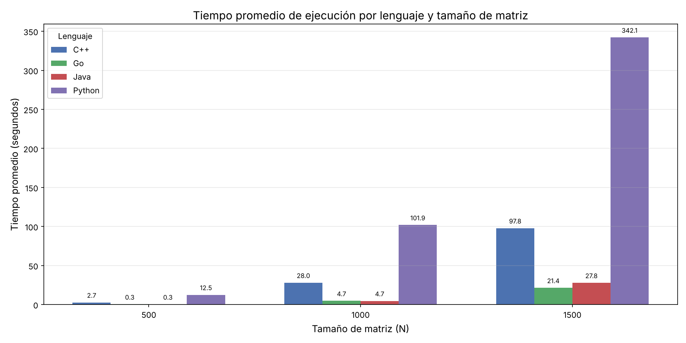
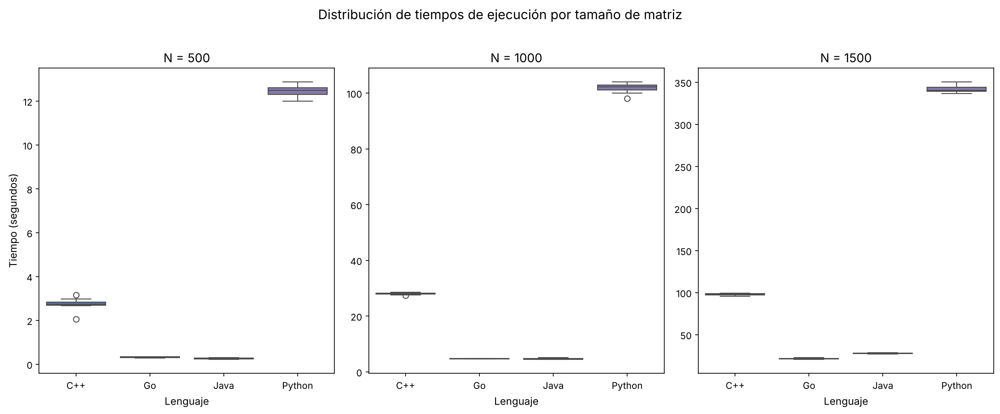
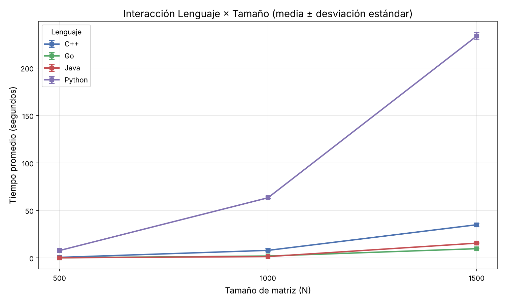
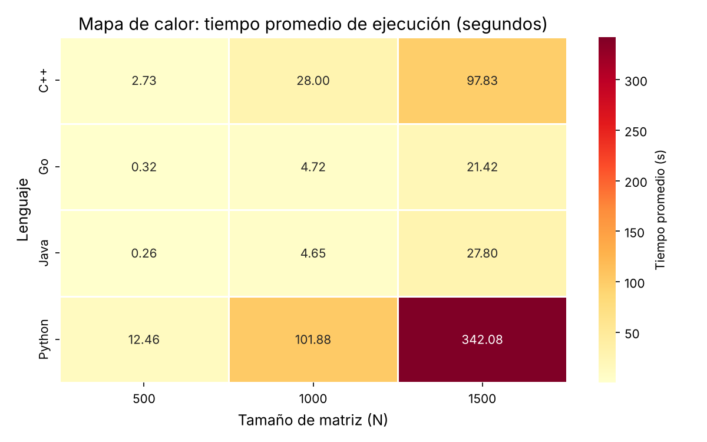
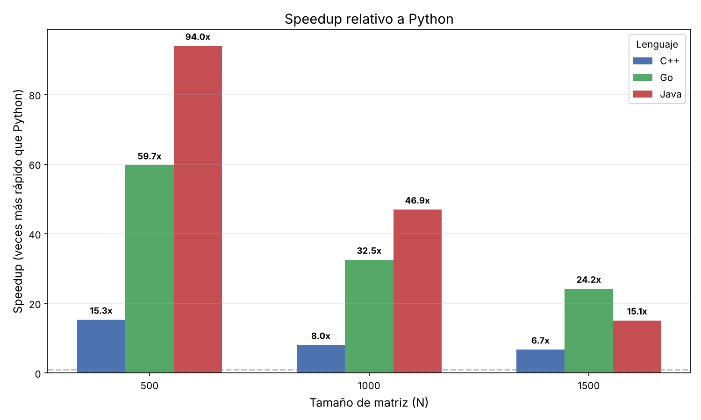

# Benchmark Reproducible de Multiplicación de Matrices NxN

## Descripción

Experimento computacional reproducible que compara el tiempo de ejecución del algoritmo **naive** de multiplicación de matrices cuadradas NxN implementado en **C++**, **Go**, **Java** y **Python**.

El proyecto sigue los principios de reproducibilidad y replicabilidad científica alineados con [ACM Artifact Review & Badging](https://www.acm.org/publications/policies/artifact-review-and-badging-current).

**DOI**: [Pendiente - asignado por Zenodo]

---

## Pregunta de investigación

> ¿Existen diferencias estadísticamente significativas en el tiempo de ejecución del algoritmo naive de multiplicación de matrices NxN entre implementaciones equivalentes desarrolladas en C++, Go, Java y Python, y cómo varían estas diferencias según el tamaño de la matriz?

## Hipótesis

- **H₀**: El lenguaje de implementación no produce diferencias estadísticamente significativas en el tiempo de ejecución del algoritmo de multiplicación de matrices.
- **H₁**: Al menos uno de los lenguajes presenta un tiempo de ejecución significativamente diferente de los demás.

## Variables

| Variable | Tipo | Valores |
|----------|------|---------|
| **Lenguaje de programación** | Independiente (factor) | C++, Go, Java, Python |
| **Tamaño de matriz (N)** | Independiente (factor) | 500, 1000, 1500 |
| **Tiempo de ejecución** | Dependiente | Segundos (float) |
| **Repetición** | Control | 10 por combinación |
| **Semilla del generador** | Control | 42 (fija) |

## Diseño experimental

- **Algoritmo**: Multiplicación naive O(n³) con triple bucle anidado.
- **Generación de datos**: Generador lineal congruencial (LCG) con semilla fija, idéntico en los 4 lenguajes para garantizar las mismas matrices de entrada.
- **Medición**: Solo se cronometra la operación de multiplicación. La generación e inicialización de matrices se excluye del tiempo medido.
- **Repeticiones**: 10 ejecuciones por cada combinación (lenguaje, N).
- **Total de observaciones**: 4 × 3 × 10 = 120 mediciones.
- **Análisis**: ANOVA de dos factores con interacción + comparaciones post-hoc Tukey HSD.

---

## Estructura del repositorio

```
matrix-benchmark/
├── README.md                          # Este archivo
├── LICENSE                            # Licencia MIT
├── FAIR_datasheet.md                  # Mini datasheet FAIR
├── Snakefile                          # Pipeline de automatizacion
├── build_docker.sh                    # Construccion manual de imagenes Docker (Linux/macOS)
├── build_docker.ps1                   # Construccion manual de imagenes Docker (Windows)
├── run_experiment.sh                  # Ejecucion del pipeline completo (Linux/macOS)
├── run_experiment.ps1                 # Ejecucion del pipeline completo (Windows)
├── run_native.sh                      # Ejecucion nativa sin Docker (Linux/macOS)
├── verify_week4.ps1                   # Verificacion de requisitos Semana 4 (Windows)
├── implementations/
│   ├── cpp/
│   │   ├── matrix_mult.cpp            # Implementación C++
│   │   └── Dockerfile
│   ├── go/
│   │   ├── matrix_mult.go             # Implementación Go
│   │   └── Dockerfile
│   ├── java/
│   │   ├── MatrixMult.java            # Implementación Java
│   │   └── Dockerfile
│   └── python/
│       ├── matrix_mult.py             # Implementación Python
│       └── Dockerfile
├── analysis/
│   ├── analyze.py                     # Script de análisis estadístico
│   └── requirements.txt               # Dependencias Python
└── results/                           # Resultados generados (no versionados)
    ├── cpp.csv
    ├── go.csv
    ├── java.csv
    ├── python.csv
    ├── benchmark.csv
    ├── descriptive_stats.csv
    ├── anova_results.txt
    ├── tukey_results.txt
    ├── boxplot_by_language.png
    ├── interaction_plot.png
    ├── bar_chart_comparison.png
    ├── boxplot_comparison.png
    ├── heatmap_times.png
    ├── speedup_chart.png
    └── interaction_chart.png
```

---

## Resultados por lenguaje

Los resultados de cada implementación se almacenan en archivos CSV independientes, uno por lenguaje:

| Archivo | Lenguaje |
|---------|----------|
| [`cpp.csv`](results/cpp.csv) | C++ |
| [`go.csv`](results/go.csv) | Go |
| [`java.csv`](results/java.csv) | Java |
| [`python.csv`](results/python.csv) | Python |

Los cuatro archivos comparten la misma estructura tabular:

| Columna | Tipo | Descripción |
|---------|------|-------------|
| `language` | string | Lenguaje utilizado (`cpp`, `go`, `java`, `python`) |
| `N` | int | Tamaño de la matriz |
| `repetition` | int | Número de la ejecución (1–10) |
| `time_seconds` | float | Tiempo empleado en la multiplicación de las matrices (segundos) |

El archivo consolidado [`benchmark.csv`](results/benchmark.csv) integra las 120 observaciones (4 lenguajes × 3 tamaños × 10 repeticiones).

---

## Código fuente de las implementaciones

| Lenguaje | Código fuente | Dockerfile |
|----------|--------------|------------|
| **C++** | [`matrix_mult.cpp`](implementations/cpp/matrix_mult.cpp) | [`Dockerfile`](implementations/cpp/Dockerfile) |
| **Go** | [`matrix_mult.go`](implementations/go/matrix_mult.go) | [`Dockerfile`](implementations/go/Dockerfile) |
| **Java** | [`MatrixMult.java`](implementations/java/MatrixMult.java) | [`Dockerfile`](implementations/java/Dockerfile) |
| **Python** | [`matrix_mult.py`](implementations/python/matrix_mult.py) | [`Dockerfile`](implementations/python/Dockerfile) |

## Presentaciones

| Semana | Archivo | Contenido |
|--------|---------|-----------|
| **Semana 2** | [`Semana2_Benchmark_Matrices.pptx`](results/Semana2_Benchmark_Matrices.pptx) | Implementación, decisiones de diseño, entorno y primeros resultados |
| **Semana 3** | [`Semana3_Benchmark.pptx`](results/Semana3_Benchmark.pptx) | Resultados de benchmark Semana 3 |

---

## Requisitos previos

### Opcion A: Ejecucion con Docker (Linux/macOS)

- [Docker](https://docs.docker.com/get-docker/) >= 24.0
- [Snakemake](https://snakemake.readthedocs.io/) >= 8.0
- Python >= 3.10
- Dependencias de analisis: `pip install -r analysis/requirements.txt`

### Opcion B: Ejecucion nativa (Windows/Linux/macOS)

- g++ (C++17), Go >= 1.22, JDK >= 21, Python >= 3.10
- [Snakemake](https://snakemake.readthedocs.io/) >= 8.0 (opcional, para pipeline automatizado)
- Dependencias de analisis: `pip install -r analysis/requirements.txt`

---

## Instrucciones de reproducción

### Paso 1: Clonar el repositorio

```bash
git clone https://github.com/jffp-alt/matrix-benchmark.git
cd matrix-benchmark
```

### Paso 2: Construir las imagenes Docker manualmente

Las imagenes **deben construirse manualmente** antes de ejecutar el pipeline. No se utilizan imagenes pre-construidas de registros externos (Docker Hub, GHCR, etc.):

```bash
# Opcion A: Script automatizado
chmod +x build_docker.sh
./build_docker.sh

# Opcion B: Comandos individuales
docker build -t matrix-cpp implementations/cpp/
docker build -t matrix-go implementations/go/
docker build -t matrix-java implementations/java/
docker build -t matrix-python implementations/python/
```

En Windows (PowerShell):
```powershell
powershell -ExecutionPolicy Bypass -File build_docker.ps1
```

### Paso 3: Instalar dependencias de analisis

```bash
pip install -r analysis/requirements.txt
```

### Paso 4: Ejecutar el pipeline completo

```bash
snakemake --cores 1 --forceall
```

> **Nota**: El flag `--forceall` garantiza que todas las etapas se ejecuten desde cero, ignorando resultados previos. Esto asegura la reproducibilidad completa del experimento.

Este comando ejecuta automaticamente:

1. Los 4 contenedores Docker para N = 500, 1000 y 1500 (10 repeticiones cada uno).
2. Genera los archivos `cpp.csv`, `go.csv`, `java.csv` y `python.csv`.
3. Integra los resultados en `benchmark.csv`.
4. Ejecuta el analisis estadistico (ANOVA + Tukey HSD).
5. Genera tablas y graficos en `results/`.

### Ejecución nativa sin Docker (alternativa)

Si Docker no está disponible, se puede ejecutar todo el experimento nativamente (requiere g++, go, javac y python3 instalados):

```bash
chmod +x run_native.sh
./run_native.sh
```

Este script compila, ejecuta los 4 benchmarks, integra los CSVs y corre el análisis estadístico completo.

> **Nota**: La ejecución completa (especialmente Python N=1500) puede tomar más de 1 hora.

### Ejecucion en Windows (PowerShell)

Para ejecutar el experimento completo en Windows:

```powershell
# Paso 1: Construir imagenes Docker manualmente (una sola vez)
powershell -ExecutionPolicy Bypass -File build_docker.ps1

# Paso 2: Ejecutar el pipeline completo (limpia resultados previos y re-ejecuta todo)
powershell -ExecutionPolicy Bypass -File run_experiment.ps1

# Paso 3: Verificar que se cumplen los requisitos de Semana 4
powershell -ExecutionPolicy Bypass -File verify_week4.ps1
```

El script `run_experiment.ps1` verifica que las imagenes Docker existan, limpia resultados previos, ejecuta el pipeline Snakemake con `--forceall` y verifica los artefactos generados.

### Ejecucion paso a paso (alternativa)

Si se prefiere ejecutar cada etapa por separado:

```bash
# Ejecutar un solo lenguaje y tamaño
docker run --rm -v $(pwd)/results:/output matrix-cpp --n 500 --reps 10 --seed 42 --output /output/cpp_N500.csv

# Solo el análisis (si ya existe benchmark.csv)
python analysis/analyze.py --input results/benchmark.csv --output-dir results/
```

---

## Entorno de ejecución

Características del hardware y software donde se ejecutó el experimento:

### Hardware y sistema operativo

Los resultados actuales fueron obtenidos en ejecucion nativa (sin Docker) en el siguiente entorno:

| Componente | Valor |
|------------|-------|
| **Procesador** | Intel(R) Core(TM) i7-1255U @ 2.60GHz (12th Gen, 10 cores) |
| **Memoria RAM** | 16 GB DDR4 |
| **Sistema operativo** | Windows 11 |
| **Arquitectura** | x86_64 |
| **Equipo** | Notebook |

### Lenguajes, compiladores y versiones

Los resultados fueron generados en ejecucion nativa con los siguientes compiladores/interpretes:

| Lenguaje | Compilador / Runtime | Version | Flags |
|----------|---------------------|---------|-------|
| **C++** | MinGW GCC | g++ (MinGW-W64) | `-O0 -std=c++17` (sin optimizacion) |
| **Go** | Go | 1.22+ | `go build` (configuracion por defecto) |
| **Java** | OpenJDK (HotSpot JVM) | 21+ | `javac` + `java` |
| **Python** | CPython | 3.12 | Interpretado, sin extensiones C |

> **Nota**: C++ se compila con `-O0` para deshabilitar las optimizaciones del compilador y comparar el rendimiento del algoritmo puro, no la capacidad de optimizacion de cada toolchain.

### Entorno Docker (alternativa)

El experimento tambien puede reproducirse con Docker, donde cada lenguaje se ejecuta en su propia imagen oficial:

| Lenguaje | Imagen Docker | Compilador / Runtime |
|----------|--------------|---------------------|
| **C++** | `gcc:13` | GCC 13.x |
| **Go** | `golang:1.22` | Go 1.22.x |
| **Java** | `eclipse-temurin:21` | OpenJDK 21 |
| **Python** | `python:3.12-slim` | CPython 3.12 |

---

## Formato de resultados

Cada archivo CSV sigue la estructura:

| Columna | Tipo | Descripción |
|---------|------|-------------|
| `language` | string | Lenguaje (`cpp`, `go`, `java`, `python`) |
| `N` | int | Tamaño de la matriz |
| `repetition` | int | Número de repetición (1-10) |
| `time_seconds` | float | Tiempo de multiplicación en segundos |

---

## Análisis estadístico

### Tiempos promedio de ejecucion (segundos)

| Lenguaje | N=500 | N=1000 | N=1500 |
|----------|-------|--------|--------|
| **C++** | 0.505 | 7.894 | 34.856 |
| **Go** | 0.129 | 1.948 | 9.657 |
| **Java** | 0.082 | 1.349 | 15.479 |
| **Python** | 7.715 | 63.322 | 233.613 |

### Comparacion de tiempos promedio



### Distribución de tiempos (Boxplot)



### Gráfico de interacción: Lenguaje × Tamaño



### Mapa de calor de tiempos promedio



### Speedup relativo a Python



### ANOVA de dos factores

Todos los factores y su interacción son estadísticamente significativos (p < 0.001):

| Factor | F | p-valor | Significancia |
|--------|---|---------|---------------|
| Lenguaje | 40,162.62 | 2.16 × 10⁻¹⁶⁴ | *** |
| Tamaño (N) | 33,751.04 | 9.64 × 10⁻¹⁵² | *** |
| Lenguaje × Tamaño | 17,587.96 | 5.08 × 10⁻¹⁵⁹ | *** |

### Comparaciones post-hoc (Tukey HSD)

Al colapsar por tamaño, las diferencias entre C++, Go y Java **no** son significativas entre sí (p > 0.05), pero los tres son significativamente más rápidos que Python (p < 0.001).

### Archivos generados

El script `analysis/analyze.py` genera:

- [`descriptive_stats.csv`](results/descriptive_stats.csv) — Media, desviación estándar, mediana, mín/máx por grupo.
- [`anova_results.txt`](results/anova_results.txt) — ANOVA de dos factores (lenguaje × tamaño) con interacción.
- [`tukey_results.txt`](results/tukey_results.txt) — Comparaciones múltiples post-hoc Tukey HSD.
- [`boxplot_by_language.png`](results/boxplot_by_language.png) — Boxplot agrupado por lenguaje y tamaño.
- [`interaction_plot.png`](results/interaction_plot.png) — Gráfico de interacción Lenguaje × Tamaño.
- [`bar_chart_comparison.png`](results/bar_chart_comparison.png) — Comparación de barras de tiempos promedio.
- [`boxplot_comparison.png`](results/boxplot_comparison.png) — Boxplots comparativos por tamaño de matriz.
- [`heatmap_times.png`](results/heatmap_times.png) — Mapa de calor de tiempos promedio.
- [`speedup_chart.png`](results/speedup_chart.png) — Speedup relativo a Python.
- [`interaction_chart.png`](results/interaction_chart.png) — Gráfico de interacción con barras de error.

---

## Criterios ACM Artifact Review & Badging

Este artifact está diseñado para cumplir con:

- **Functional**: El código se ejecuta correctamente y produce los resultados documentados.
- **Reusable**: Pipeline automatizado (Snakemake), entornos reproducibles (Docker), semilla fija, documentación completa.
- **Available**: Publicado en Zenodo con DOI y licencia abierta (MIT).

---

## Licencia

Este proyecto está bajo la licencia [MIT](LICENSE).

## Bibliografía

- ACM Artifact Review and Badging: https://www.acm.org/publications/policies/artifact-review-and-badging-current
- Reproducibility and Replicability in Science: https://nap.nationalacademies.org/catalog/25303/reproducibility-and-replicability-in-science
- Best Practices for Replicability, Reproducibility and Reusability: https://arxiv.org/pdf/1607.01191.pdf
